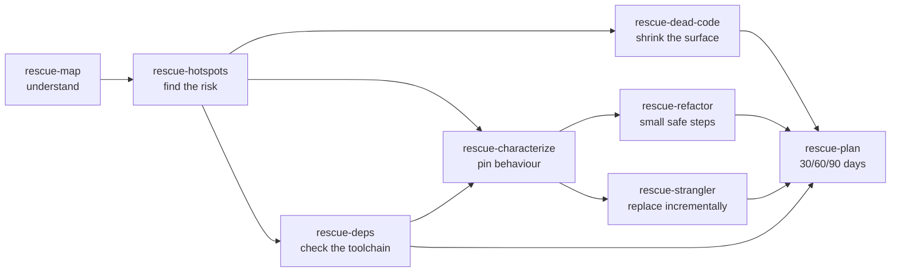

# Legacy Rescue

**You just inherited a codebase nobody understands. Rescue it without breaking production.**

[](LICENSE)
[](#install)

The original authors left. The README describes a system that no longer exists. There are
four tests, two of them skipped. Every change to `billing/` breaks something in `reports/`,
and the one person who understood the payment flow is on a different team now. You have been
asked to "just add a small feature" and to "modernise it while you are in there".

Legacy Rescue is a set of Claude Code skills that follow the order experienced maintainers
use: **understand first, put a safety net under it, then change it in small, reversible
steps.** It maps the repository, ranks the risky files from git history, pins current
behaviour with characterization tests before anything moves, plans dependency upgrades and
migrations one revertible step at a time, and compiles it all into a 30/60/90-day plan with a
risk register.

What you get is a `rescue/` folder in your project with evidence you can show your team: a
system map with a module diagram, a ranked hotspot list, dead-code candidates with confidence
levels, an upgrade path, migration plans and a plan your manager can read in one page. Nothing
is deleted, upgraded or pushed without you saying yes.

## What's inside

### Skills

| Skill | What it does | Writes |
|-------|--------------|--------|
| [`rescue-map`](skills/rescue-map/SKILL.md) | Maps languages, entry points, build/run/test commands, module boundaries, data stores, external services and env vars. Mermaid module diagram and a "where to start reading" list. Read-only. | `rescue/map.md` |
| [`rescue-hotspots`](skills/rescue-hotspots/SKILL.md) | Ranks risky files by git churn x complexity, finds files that always change together, and busy files only one person knows. | `rescue/hotspots.md` |
| [`rescue-dead-code`](skills/rescue-dead-code/SKILL.md) | Finds orphan files, unused exports and dependencies, stale feature flags, constant conditions and commented-out code, with confidence levels. Deletes only approved batches. | `rescue/dead-code.md` |
| [`rescue-characterize`](skills/rescue-characterize/SKILL.md) | Writes golden-master tests that pin today's behaviour, bugs included, in your existing test framework. Finds seams; breaks dependencies minimally. | tests + `rescue/characterization.md` |
| [`rescue-deps`](skills/rescue-deps/SKILL.md) | Audits runtimes and packages with your package manager's own commands and builds a risk-rated, one-step-at-a-time upgrade path. | `rescue/deps.md` |
| [`rescue-strangler`](skills/rescue-strangler/SKILL.md) | Plans a replacement with strangler fig routing, branch by abstraction or parallel run. Every milestone ships alone and rolls back. | `rescue/strangler-<name>.md` |
| [`rescue-refactor`](skills/rescue-refactor/SKILL.md) | One named, behaviour-preserving refactoring per commit, tests green before and after, revert on red. | commits + `rescue/refactor-log.md` |
| [`rescue-plan`](skills/rescue-plan/SKILL.md) | Compiles everything into a 30/60/90-day plan with exit criteria, a risk register and a one-page summary. | `rescue/PLAN.md` |

### Agents

| Agent | Role | Tools |
|-------|------|-------|
| [`legacy-cartographer`](agents/legacy-cartographer.md) | Read-only mapper for large repos or one sub-system. Returns a sourced map draft. | Read, Grep, Glob, Bash |
| [`safety-net-builder`](agents/safety-net-builder.md) | Writes characterization tests only. Never changes production code; proposes seam edits as diffs. | Read, Grep, Glob, Bash, Write, Edit |
| [`upgrade-planner`](agents/upgrade-planner.md) | Read-only dependency and runtime upgrade strategist. | Read, Grep, Glob, Bash |

### Helper scripts

Python 3.9+, standard library only, no network, deterministic. Each has `--help` and tests.

- `skills/rescue-map/inventory.py`: languages, directories, manifests, commands, entry points, env vars, service hints.
- `skills/rescue-hotspots/hotspots.py`: parses `git log --numstat` (runs git itself or reads a saved log), scores churn x complexity, change coupling, knowledge risk. Markdown, JSON or CSV.
- `skills/rescue-dead-code/dead_code_scan.py`: commented-out code blocks, constant conditions, orphan files.
- `skills/rescue-deps/outdated_report.py`: turns `npm outdated --json`, `pip list --outdated --format=json`, `composer outdated --format=json` or a CSV into an ordered upgrade path.

## Install

From Claude Code:

```
/plugin marketplace add vivekbhange-hub/legacy-rescue-skill
/plugin install legacy-rescue-skill@legacy-rescue-skill
```

Manual install: copy the folders in `skills/` into `~/.claude/skills/` and the files in
`agents/` into `~/.claude/agents/`. The helper scripts need Python 3.9 or newer on your PATH
(as `python3`, or `python` on Windows).

## Try it in 60 seconds

Open Claude Code in the repository you inherited and say:

> I just inherited this codebase. Map it, then show me the hotspots.

Claude runs `rescue-map` and then `rescue-hotspots`, and writes `rescue/map.md` and
`rescue/hotspots.md`. You can also run the hotspot script on its own:

```
python3 skills/rescue-hotspots/hotspots.py --repo /path/to/your/repo --since "12 months ago" --top 5
```

Example output (illustrative, from a made-up shop application):

```
## Top hotspots

| # | File                         | Commits | Authors | +/- lines  | LOC  | Max depth | Branches | Complexity | Score   |
|---|------------------------------|---------|---------|------------|------|-----------|----------|------------|---------|
| 1 | `app/services/checkout.rb`   | 41      | 6       | +2210/-930 | 812  | 9         | 188      | 397.2      | 16285.2 |
| 2 | `app/models/order.rb`        | 37      | 5       | +1450/-612 | 640  | 6         | 121      | 300.6      | 11122.2 |
| 3 | `lib/tax/calculator.rb`      | 18      | 1       | +690/-201  | 455  | 8         | 97       | 230.3      | 4145.4  |

## Change coupling

| File A                       | File B                       | Shared commits | Degree | Same directory |
|------------------------------|------------------------------|----------------|--------|----------------|
| `app/models/order.rb`        | `app/reports/sales_csv.rb`   | 9              | 0.75   | no             |
```

Read it as: `checkout.rb` changes almost weekly and is the hardest file to read, so pin it
with `rescue-characterize` before anyone touches it. `order.rb` and `sales_csv.rb` change
together across directories, which usually means a hidden dependency. `tax/calculator.rb` has
one author: talk to them first.

## How it works



1. **Understand.** `rescue-map` describes the system with a file path behind every claim.
   `rescue-hotspots` turns "everything is a mess" into a ranked list.
2. **Protect.** `rescue-characterize` pins what the top hotspots do today, so any later
   change that alters behaviour fails a test immediately. Bugs are pinned too, and named.
3. **Change.** `rescue-refactor` moves in single named refactorings with a revert on red.
   `rescue-strangler` grows a replacement next to the old code and moves traffic slice by
   slice. `rescue-deps` and `rescue-dead-code` shrink and update the ground underneath.
4. **Plan.** `rescue-plan` sequences all of it by that same principle and fits it to your
   team's capacity, with exit criteria per phase and a risk register.

Every skill writes into `rescue/` in your project, so the next skill (or the next person)
builds on evidence instead of a chat transcript.

## Principles and limits

- **Understand, protect, then change.** No skill refactors code that is not pinned by tests.
- **Small and reversible.** One refactoring, one deletion batch, one major upgrade per commit.
- **You approve every change.** Deleting code, upgrading packages and any edit to production
  code wait for an explicit yes. Nothing is pushed, merged or posted.
- **Evidence over opinion.** Claims cite files; anything unconfirmed is listed as unknown.

What it will not do:

- It does not understand your business. It can tell you `checkout.rb` is risky, not whether
  the discount rule inside it is still wanted. That is a conversation with your team.
- The hotspot complexity score is a text-based estimate that works across languages. It ranks
  files; it is not a code-quality grade and should never be used to rank people.
- The dead-code scan cannot see reflection, routing by convention, templates or callers
  outside the repository. Its findings are leads, which is why deletions need your approval.
- Characterization tests pin behaviour; they do not prove it correct. Pinned bugs stay bugs
  until someone decides to fix them.
- End-of-life dates for runtimes come from the model's training data and must be verified.
- It does not run your production systems, read your logs, or access anything outside the
  repository unless you give it that output.

## Contributing

Issues and pull requests are welcome. See [CONTRIBUTING.md](CONTRIBUTING.md). Run the tests
with:

```
python -m unittest discover -s tests -v
```

## License

[MIT](LICENSE) © 2026 Vivek Bhange
