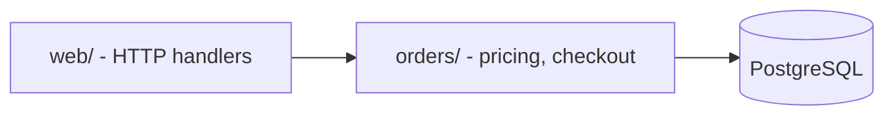

# rescue-map

You are drawing the map before the rescue. Nobody fixes what they cannot find. This skill
reads the repository, never runs or changes it, and writes one document a new maintainer can
trust: what the system is made of, how to start it, what it depends on, and which twenty files
to read first. Every statement in the map points at a file. If you could not confirm
something, it goes under "Unknowns", not into the map.

## Inputs

- `$ARGUMENTS`: path to the repository or a sub-folder. Default: the current directory.
- Optional: anything the user already knows ("it is a Django monolith", "prod runs on ECS").
  Treat it as a claim to verify, not a fact.

## Output

- `rescue/map.md` in the user's repository (create `rescue/` if needed).
- `rescue/inventory.md`, the raw output of the inventory script, kept as evidence.

## Steps

1. **Check the ground.** Run `git status --short | head -20` and `git log -1 --format='%h %ad %an' --date=short`.
   Note uncommitted changes and the age of the last commit. If the folder is not a git repo,
   say so; later skills (hotspots) need history.

2. **Take the inventory.** Run:
   ```
   python3 "${CLAUDE_SKILL_DIR}/inventory.py" <path> --output rescue/inventory.md
   ```
   It lists languages, top-level directories with sizes, manifests, CI and container files,
   declared commands (package.json scripts, Makefile targets, Procfile), likely entry points,
   environment variables the code reads and keyword hints of data stores and services. Skip
   extra vendored folders with `--skip <name>`. On Windows use `python` if `python3` is missing.

3. **Read the front door.** Read, in this order, whichever exist: README, CONTRIBUTING, docs/
   index, the main manifest (package.json, pyproject.toml, pom.xml, go.mod, *.csproj, Gemfile),
   Dockerfile and compose files, CI workflow files. CI is the most honest documentation of how
   the project is really built and tested; prefer it over the README when they disagree, and
   record the disagreement.

4. **Pin the commands.** Fill a table of build, run, test, lint and migrate commands. For each,
   give the source (CI file line, script name, README section). Mark any command you only
   inferred as `(inferred)`. Do not run them here; `rescue-characterize` will run the tests.

5. **Trace the entry points.** For each likely entry point from the inventory, open it and
   follow one level down: what it wires up (routes, CLI commands, job handlers, message
   consumers, cron schedules). Use Grep for registration patterns such as `app.get(`,
   `@app.route`, `urlpatterns`, `@RestController`, `router.`, `consumer`, `schedule`, `cron`.

6. **Find the module boundaries.** Start from top-level and second-level directories. For each
   candidate module, Grep its imports to see what it depends on. Draw edges only for
   dependencies you saw in an import, include, require or call; label each edge with one
   example file. More than about 12 nodes: group the leaves.

7. **List data stores and external services.** Confirm each keyword hint from the inventory by
   opening the file: a connection string, client construction, ORM config or HTTP base URL.
   Drop hints you cannot confirm. For each confirmed one record: what it is, where it is
   configured, which env vars it needs, which modules touch it.

8. **List configuration.** From the inventory env var table plus config files, list every
   variable with where it is read, whether a default exists in code, and whether it looks like
   a secret (name contains KEY, SECRET, TOKEN, PASSWORD, DSN). Never print secret values,
   even if a committed .env file contains them; instead record "secret committed in <file>"
   as a risk.

9. **Pick where to start reading.** Choose 10 to 20 files in reading order: entry point,
   the router or dispatcher, the two or three busiest domain modules, the data access layer,
   one representative test. One line each on why it matters.

10. **Write `rescue/map.md`** using the template below, then tell the user the three most
    surprising findings and the next step.

## Template for rescue/map.md

~~~markdown
# System map: <repo name>
Mapped <date> at commit <short sha>. Read-only survey; nothing was run or changed.

## In one paragraph
<what this system does, for whom, in plain words, with the evidence file>

## Stack
| Layer | Technology | Evidence |

## How to build, run and test
| Task | Command | Source |

## Entry points
| Entry | Kind (HTTP, CLI, job, consumer) | File |

## Modules

| Module | Responsibility | Depends on | Size (files / lines) |

## Data stores and external services
| Name | Kind | Configured in | Env vars | Used by |

## Configuration
| Variable | Read in | Default | Secret? |

## Where to start reading
1. `path` - why

## Risks noticed while mapping
- <e.g. no tests for billing/, secrets in config/prod.yml, two ORMs in use>

## Unknowns
- <questions only a human or production access can answer>
~~~

## Decision rules

- A fact needs a file path. No path, no fact; move it to Unknowns.
- Prefer CI config over README over your own inference.
- If the repo has more than one deployable (monorepo), map each deployable as a top-level
  node and give each its own commands table.
- If there are zero tests, say so in the first paragraph. It changes the whole plan.
- Generated code, vendored code and migrations are named once and then ignored.

## What NOT to do

- Do not run the application, its tests, migrations or install commands.
- Do not edit, format or "tidy" any file. The only files you write are under `rescue/`.
- Do not copy secret values into the map, the chat or any file.
- Do not invent architecture from folder names alone; open the files.
- Do not judge the code yet. Mapping is description; judgement comes with the plan.

## Hand-off

Next: run `rescue-hotspots` to find where the risk concentrates. If the map shows no test
suite at all, tell the user that `rescue-characterize` is the critical path before any change.
`rescue-plan` will read `rescue/map.md` later. For large repos you can delegate the reading to
the `legacy-cartographer` agent and review its draft.
